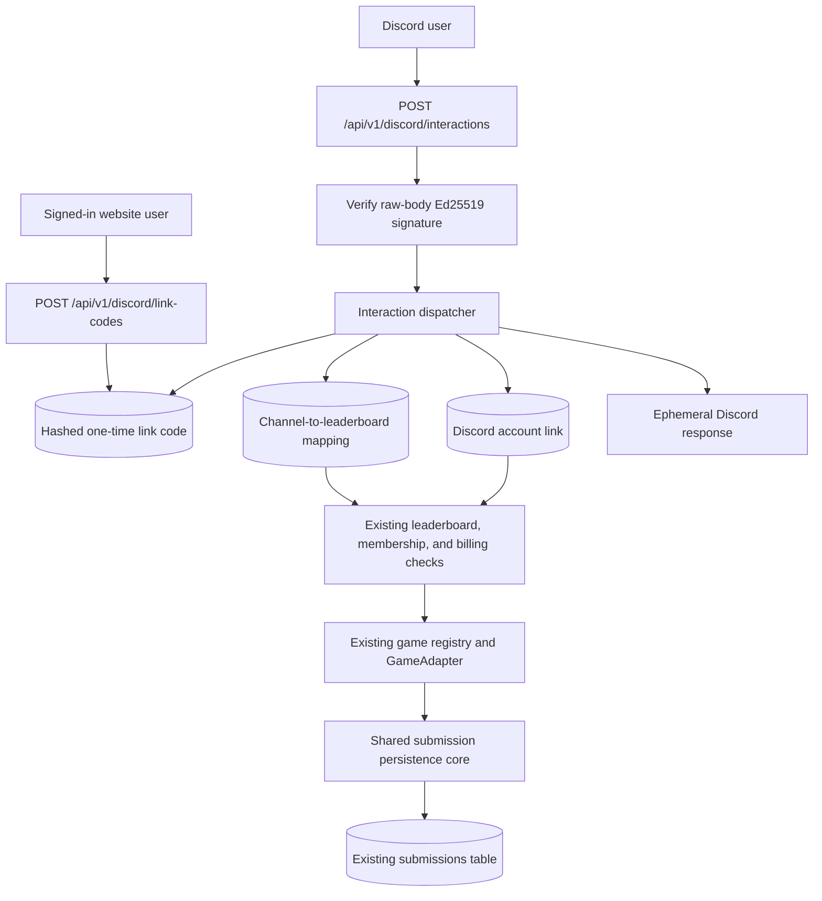

# Discord Daily Game Integration — Reconciled Technical Plan

> Historical implementation plan, reconciled against the backend on 2026-11-03. The shipped `/daily` command now requires a fixed `game` choice plus `result`, and mapped multi-game leaderboards accept every active game.

## 1. Objective

Add a Discord application to the existing Spring Boot deployment so linked Daily Tracker users can submit supported game share text from configured Discord channels. The backend remains authoritative for identity linking, channel mapping, leaderboard authorization, parsing, duplicate detection, and persistence.

Discord interactions should use the existing HTTPS application. A separate Gateway-connected bot process is not required for slash commands or message commands.

## 2. Current backend reality

The mockup assumed a separate player identifier and a leaderboard-scoped submission API. Neither exists in the current application.

| Area | Current implementation | Consequence for Discord |
| --- | --- | --- |
| Identity | `app_users.id` is the authenticated user ID. `profiles.user_id` is the same UUID. A profile also has a public `share_id` for adding leaderboard members. | Link Discord directly to `profiles.user_id`. Do not create a player UUID or ask users to paste either UUID into Discord. |
| Authentication | The website uses an HTTP-only `daily_games_session` cookie resolved by `SessionAuthenticationFilter`. | Discord cannot reuse browser authentication. Linking must bridge a signed-in website session to a Discord identity. |
| Games | The active catalog contains `fermi` and `krillion`, each with a `GameAdapter`. | Only Fermi and Krillion share text is supported initially. Connections examples from the mockup are invalid. |
| Leaderboards | Each leaderboard has one game, one owner, explicit members, and a billing-dependent lock state. | A channel mapping selects the leaderboard and therefore the game. Setup must check ownership; submission must check membership and lock state. |
| Submissions | A submission belongs to a user and game—not a leaderboard. Uniqueness is `(user_id, game_id, puzzle_key)`. | One saved result appears on every same-game leaderboard containing that user. A channel mapping supplies context and authorization; it is not stored on the submission. |
| Submission API | Website submission is two-step: `POST /api/v1/submissions/preview`, then `POST /api/v1/submissions` with raw text and confirmed fields. | There is no `/api/games/daily` or `DailyGameService`. Add a shared internal submission core instead of making a loopback HTTP request. |
| Security | CSRF and CORS are globally disabled. All routes except an allowlist require website authentication. `OriginValidationFilter` rejects mismatched non-null origins on mutating requests. | Permit only the Discord interaction route without a website session. Discord sends no browser `Origin`; Ed25519 verification authenticates this route. No CSRF exemption is needed. |

This repository contains only the backend, so the mockup's claim that a player UUID is already visible and copyable on the account page cannot be verified here. The revised design does not depend on that claim.

## 3. Recommended MVP

### 3.1 Commands

| Command | Who may run it | Arguments | Purpose |
| --- | --- | --- | --- |
| `/link` | User with a website-issued code | `code` | Link the invoking Discord user to the profile that issued the one-time code. |
| `/setup` | Manage Guild member with a linked profile | `leaderboard` | Map the current channel to a leaderboard owned by the linked website user. |
| `/daily` | Linked member in a configured channel | `result` | Parse and save a result for the mapped leaderboard's game. |
| `/unlink` | Linked user | none | Remove the invoking Discord identity's website link. |
| **Submit Daily** | Optional post-MVP message command | target message | Submit an existing message through the same validation path. |

Register MVP commands for guild context only. Set `/setup`'s `default_member_permissions` to Manage Guild and still re-check the permission from the verified payload; command visibility is not authorization.

Discord string options allow at most 6,000 characters, so `/daily result` is capped below the website's 10,000-character limit. This is sufficient for both current share formats.

### 3.2 Account linking

Do not use `user_id` or `share_id` as a credential.

1. A signed-in, onboarded user requests a code from `POST /api/v1/discord/link-codes`.
2. The backend creates a short-lived one-time code, stores only its hash, and returns the plaintext once.
3. The user runs `/link code:<code>`.
4. The signed interaction supplies the trusted Discord user ID. The backend hashes and atomically consumes the code.
5. The backend creates or replaces the one-to-one `discord_user_id <-> user_id` link.
6. Discord returns an ephemeral success response. Invalid, expired, consumed, and rate-limited codes share a non-enumerating error.

Recommended code policy: 10–12 unambiguous Base32 characters from a secure random source, 10-minute expiry, SHA-256 at rest, one active code per user, atomic single use, and rate limits on issuance and redemption.

Provide both website and Discord unlink paths. The website path is required for recovery if the Discord account is lost. Enforce one Discord identity per website profile and vice versa in the MVP.

Frontend work is required: add an authenticated account/settings control that requests a link code, displays its expiry, lets the user copy it, and lets an already-linked user unlink Discord. No UUID needs to be displayed for this flow.

### 3.3 Channel setup

1. A linked user runs `/setup leaderboard:<UUID>` in a guild channel.
2. Verify the signature before reading interaction fields.
3. Require `guild_id`, `channel_id`, and `member.user.id`.
4. Require Manage Guild or Administrator in the member-permissions bitset.
5. Resolve the Discord identity to `profiles.user_id`.
6. Require `leaderboard.owner_id == linked user_id`. The site currently has owner/member roles only; there is no separate website administrator role.
7. Require the leaderboard to be accessible under existing billing rules.
8. Upsert `(guild_id, channel_id) -> leaderboard_id`, recording both identities that configured it.
9. Return an ephemeral confirmation containing the leaderboard and game names.

Leaderboard UUIDs are identifiers, not secrets. Authorization comes from the linked owner check. Autocomplete over the linked user's owned leaderboards can replace manual UUID entry later.

### 3.4 Daily submission

1. A user runs `/daily result:<share text>` in a configured guild channel.
2. Resolve the exact `(guild_id, channel_id)` mapping. Thread inheritance is not in the MVP.
3. Resolve the Discord identity to a website `user_id` and require its profile.
4. Load the mapped leaderboard and its active game.
5. Re-check billing accessibility because mappings may outlive subscription changes.
6. Require the linked user to be a leaderboard member.
7. Parse with the mapped game's existing `FermiParser` or `KrillionParser`.
8. Persist through a shared submission core using the parsed values. Discord does not expose the website preview/edit screen.
9. Reuse the current unique rule: one result per user, game, and puzzle regardless of initiating channel.
10. Return an ephemeral response with the game, puzzle, and formatted score, or an actionable existing error.

Example:

```text
/daily result:Fermi #92
1.31× score
top 8%
```

```text
-> Saved Fermi #92 at 1.31×. This result now appears on your Fermi leaderboards.
```

## 4. Architecture



## 5. Service changes

### 5.1 Shared submission core

Keep the website endpoints and DTOs unchanged. Extract the common duplicate check and persistence from `DailyGamesService.submit` into a method accepting `userId`, resolved `Game`, `ParsedSubmission`, and raw text. The web method continues to call `validateConfirmed(...)` before that shared method.

Add a Discord entry point conceptually equivalent to:

```java
UUID submitFromDiscord(UUID userId, UUID leaderboardId, String rawText)
```

It must require the profile, leaderboard membership, accessible leaderboard, active game, and successful `GameAdapter.parse(rawText)`, then call the same duplicate-safe persistence used by the website.

Do not construct a fake browser session, expose a public internal-submission endpoint, or call this application over HTTP from itself.

### 5.2 Interaction service

Create a narrow service for command dispatch, option lookup by name, link-code consumption, account links, channel mappings, `submitFromDiscord`, and conversion of `ApiException` codes into ephemeral messages. Keep Discord JSON transport types and response formatting out of `DailyGamesService`.

## 6. Data model

Add one Flyway migration with explicit foreign keys, indexes, and deletion behavior.

### 6.1 `discord_account_links`

| Column | Type | Constraints / purpose |
| --- | --- | --- |
| `discord_user_id` | `VARCHAR(20)` | Primary key; Discord snowflake stored as text. |
| `user_id` | `UUID` | Unique FK to `profiles(user_id)` with `ON DELETE CASCADE`. |
| `linked_at` | `TIMESTAMPTZ` | Original link time. |
| `updated_at` | `TIMESTAMPTZ` | Last relink/update time. |

### 6.2 `discord_link_codes`

| Column | Type | Constraints / purpose |
| --- | --- | --- |
| `id` | `UUID` | Primary key. |
| `user_id` | `UUID` | FK to `profiles(user_id)` with `ON DELETE CASCADE`. |
| `code_hash` | `VARCHAR(64)` | Unique SHA-256 hex digest; never plaintext. |
| `created_at` | `TIMESTAMPTZ` | Issuance time. |
| `expires_at` | `TIMESTAMPTZ` | Short expiry. |
| `consumed_at` | `TIMESTAMPTZ NULL` | Atomic one-time-use marker. |

Index `expires_at` for cleanup. Invalidate an older active code during issuance under a lock.

### 6.3 `discord_channel_leaderboards`

| Column | Type | Constraints / purpose |
| --- | --- | --- |
| `guild_id` | `VARCHAR(20)` | Part of primary key. |
| `channel_id` | `VARCHAR(20)` | Part of primary key. |
| `leaderboard_id` | `UUID` | FK to `leaderboards(id)` with `ON DELETE CASCADE`. |
| `configured_by_user_id` | `UUID` | FK to `profiles(user_id)`. |
| `configured_by_discord_user_id` | `VARCHAR(20)` | Audit identity from the verified interaction. |
| `created_at` | `TIMESTAMPTZ` | Original mapping time. |
| `updated_at` | `TIMESTAMPTZ` | Last change. |

Primary key: `(guild_id, channel_id)`. Allow the same leaderboard in multiple channels unless product requirements later prohibit it.

### 6.4 `processed_discord_interactions`

| Column | Type | Constraints / purpose |
| --- | --- | --- |
| `interaction_id` | `VARCHAR(20)` | Primary key; deduplicates retries. |
| `interaction_type` | `INTEGER` | Discord interaction type. |
| `command_name` | `VARCHAR(32) NULL` | Command when applicable. |
| `processed_at` | `TIMESTAMPTZ` | Processing time. |

Insert the receipt in the same transaction as the mutation so failed work can retry. The submission unique constraint remains the final `/daily` duplicate defense.

## 7. HTTP contracts

### 7.1 Website link-code issuance

```http
POST /api/v1/discord/link-codes
Cookie: daily_games_session=...
```

```json
{
  "code": "7K9M-W2PD-Q4",
  "expiresAt": "2026-11-03T21:30:00Z"
}
```

Require the existing session and an onboarded profile, rate-limit issuance, invalidate previous codes, return plaintext once, send `Cache-Control: no-store`, and never log the code. Also add `DELETE /api/v1/discord/link` for website recovery/unlinking.

### 7.2 Discord ingress

```http
POST /api/v1/discord/interactions
Content-Type: application/json
X-Signature-Ed25519: <hex signature>
X-Signature-Timestamp: <timestamp>
```

Requirements:

- read the body once in its exact received form; never parse and reserialize before verification;
- verify Ed25519 over `timestamp + rawBody` with the configured application public key;
- reject missing, malformed, or invalid signatures with 401;
- optionally enforce a small configurable timestamp-skew window for replay hardening;
- answer interaction `type: 1` with HTTP 200 and `{"type":1}`;
- reject a different `application_id`;
- accept guild-context commands only in the MVP;
- permit this exact path in `SecurityConfig`, not a broad Discord prefix;
- use signature verification, not the website session, as authentication.

Discord's current Java example uses Tink's `Ed25519Verify`; `com.google.crypto.tink:tink` is a reasonable implementation dependency.

## 8. Response timing

Discord requires an initial response within 3 seconds. Interaction tokens remain valid for follow-ups for 15 minutes.

MVP operations should normally return synchronously with an ephemeral response:

```json
{
  "type": 4,
  "data": {
    "content": "Saved Fermi #92 at 1.31×.",
    "flags": 64,
    "allowed_mentions": { "parse": [] }
  }
}
```

If production latency cannot reliably meet the deadline, return deferred type `5` with flag `64` and edit the original response through the interaction webhook. Never persist or log interaction tokens. Disable allowed mentions for user-controlled response text.

## 9. Configuration and deployment

Add configuration under the existing `app` namespace:

```yaml
app:
  discord:
    application-id: ${DISCORD_APPLICATION_ID:}
    public-key: ${DISCORD_PUBLIC_KEY:}
```

The public key is not secret but must be correct. The application ID supports payload validation and follow-up webhook addressing.

A bot token is not required at runtime for HTTP interactions. The application can be installed with `applications.commands` without adding a bot user. A bot token or client-credentials bearer token is needed only by the command-registration tool; do not keep it in the web runtime unless the app itself registers commands.

Deployment sequence:

1. Create/configure the Discord application.
2. Deploy the signed endpoint and PING response first.
3. Set `https://<api-host>/api/v1/discord/interactions` as the Interactions Endpoint URL.
4. Install with `applications.commands`.
5. Register guild commands in a test guild; they update immediately.
6. Test linking, setup, membership, locked boards, both parsers, duplicates, and unlinking end to end.
7. Promote to global commands only after the guild flow is stable.

## 10. Error mapping

| Condition | Discord response |
| --- | --- |
| Missing/expired link code | `That link code is invalid or expired. Request a new one from Daily Tracker.` |
| Unlinked account | `Link your Daily Tracker account first with /link.` |
| Unconfigured channel | `This channel is not connected to a leaderboard.` |
| Non-member | `Your Daily Tracker account is not a member of this leaderboard.` |
| Locked leaderboard | User-friendly version of the existing owner-subscription-required error. |
| Invalid share text | Existing adapter's actionable `INVALID_SHARE_TEXT` message. |
| Duplicate puzzle | Existing `DUPLICATE_SUBMISSION` meaning; the result is already globally saved for that game/puzzle. |
| Unexpected failure | Generic retry response; log interaction ID and error code, not raw text or secrets. |

## 11. Security and reliability

- Verify signatures before JSON dispatch, database access, or trusting guild/member fields.
- Validate `application_id`, interaction type, command name, option types, and guild context.
- Extract the user from `member.user.id`; never accept a user ID option.
- Treat snowflakes as validated decimal strings, not JavaScript-compatible numbers.
- Re-check Discord permissions and website ownership on every `/setup`.
- Re-check membership and leaderboard accessibility on every `/daily`.
- Hash, expire, single-use, and rate-limit link codes.
- Deduplicate interaction IDs and retain database submission uniqueness.
- Keep account/authorization/validation responses ephemeral.
- Do not log link codes, interaction tokens, cookies, email addresses, or complete share text.
- Bound request sizes and outbound follow-up timeouts.

## 12. Test plan

### Signature and transport

- Valid signed PING returns `{"type":1}` without a website cookie.
- Invalid, missing, and malformed signatures return 401.
- Verification uses the untouched request body.
- A valid signature for a different application ID is rejected.
- Only the interaction route is public; neighboring routes stay authenticated.
- Duplicate interaction IDs do not repeat mutations.

### Linking

- Authenticated onboarded user can issue one code; plaintext is returned once and not stored.
- Anonymous/profile-less users cannot issue codes.
- Valid `/link` atomically consumes a code and creates the one-to-one mapping.
- Expired, reused, malformed, and rate-limited codes fail without enumeration.
- Relinking and website/Discord unlinking obey the one-to-one policy.

### Setup

- Manage Guild plus linked leaderboard owner can map a channel.
- Discord permission alone is insufficient without website ownership.
- Website ownership alone is insufficient without Discord permission.
- Missing, nonexistent, and locked leaderboards fail cleanly.
- Re-running setup updates the mapping idempotently and preserves audit data.

### Submission

- A linked member submits valid Fermi and Krillion results in mapped channels.
- Game selection always comes from the leaderboard, not a command option.
- Unlinked user, non-member, unmapped channel, locked board, and inactive/missing game fail cleanly.
- Invalid share text returns the adapter message.
- A duplicate `(user, game, puzzle)` fails even from another mapped channel.
- A successful result appears on all same-game leaderboards containing that user, matching current behavior.

### Regression and build

- Existing website preview/confirm behavior remains unchanged.
- Add service, signed-controller, repository, and PostgreSQL migration tests.
- Run `mvn test` and `mvn -DskipTests package`.

## 13. Implementation sequence

1. Add the migration and JPA entities/repositories for codes, links, mappings, and receipts.
2. Refactor `DailyGamesService` for shared persistence and add `submitFromDiscord` without changing website contracts.
3. Add authenticated website code-issuance and unlink endpoints.
4. Add Discord configuration and Ed25519 verification.
5. Add the exact permit rule and signed ingress plus PING.
6. Implement `/link` and `/unlink`.
7. Implement `/setup` with Discord permission and website ownership checks.
8. Implement `/daily` with mapping, membership, lock, parser, and duplicate checks.
9. Add rate limits, deduplication, expired-code cleanup, structured logging, and tests.
10. Register/test guild commands, deploy, then consider global commands.
11. Add **Submit Daily** only after the slash-command path is stable.

## 14. Open decisions

- Thread mappings: recommended MVP is exact channel only.
- Multiple channels per leaderboard: recommended MVP is yes.
- Manual leaderboard UUID vs autocomplete: recommended MVP is UUID first.
- Guild-only linking vs DM/user installation: recommended MVP is guild plus ephemeral response.
- **Submit Daily** message command: recommended post-MVP.
- Fermi field corrections in Discord: recommended MVP accepts the parser output exactly and directs corrections to the website.

## References

- [Discord Interactions Overview](https://docs.discord.com/developers/interactions/overview)
- [Discord Receiving and Responding to Interactions](https://docs.discord.com/developers/interactions/receiving-and-responding)
- [Discord Application Commands](https://docs.discord.com/developers/interactions/application-commands)
- [Discord OAuth2](https://docs.discord.com/developers/topics/oauth2)
- [Discord Developer Portal](https://discord.com/developers/applications)
